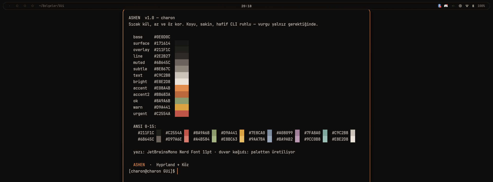

# ASHEN

> *Warm ash, a single ember. Dark, calm, a faint CLI soul — accent only when it's needed.*

A minimal **Hyprland** colour theme — ash-grey base, one ember accent. Ships colour
definitions for **waybar**, **kitty** and **hyprlock**, generated from a single source
file so one edit recolours everything.



## Palette

| token | hex | role |
|---|---|---|
| `base`    | `#0E0D0C` | background (warm black, not blue) |
| `surface` | `#171614` | raised surface |
| `overlay` | `#211F1C` | overlay / selection |
| `line`    | `#2E2B27` | separators, inactive border |
| `muted`   | `#6B645C` | muted text |
| `subtle`  | `#8E867C` | secondary text |
| `text`    | `#C9C2B8` | foreground (ash) |
| `bright`  | `#E8E2D8` | emphasis |
| `accent`  | `#E08A4B` | **ember** — the one accent |
| `accent2` | `#B8683A` | ember, dimmed (gradient end) |
| `ok`      | `#8A9A6B` | success |
| `warn`    | `#D9A441` | warning |
| `urgent`  | `#C2554A` | urgent / error |

**Font:** JetBrainsMono Nerd Font · **Wallpaper:** generated from the palette.

## Usage

The single source of truth is [`theme/ashen.lua`](theme/ashen.lua) (palette + font +
measurements). Pre-generated colour files live in [`colors/`](colors/); drop the one you
need into your own config — **this kit only writes colour variables, never your layout.**

- **waybar** `style.css` → `@import url("colors.css");` (from `colors/waybar-colors.css`)
- **kitty** `kitty.conf` → `include colors.conf` (from `colors/kitty-colors.conf`)
- **hyprlock** `hyprlock.conf` → `source = colors.conf` (from `colors/hyprlock-colors.conf`)

To tweak the palette, edit `theme/ashen.lua` and regenerate:

```sh
./gen.sh          # needs lua5.4 — rewrites colors/
```

## Contents

```
theme/ashen.lua      single source of truth (palette · font · shape · fx)
theme/generate.lua   colour-file generator
gen.sh               regenerate colors/ from the source
colors/              ready-to-use output (waybar · kitty · hyprlock)
preview/             screenshots
```

Keybinds, autostart and the rest of the rice are intentionally **not** here — this is just
the theme.

## License

MIT © charon
